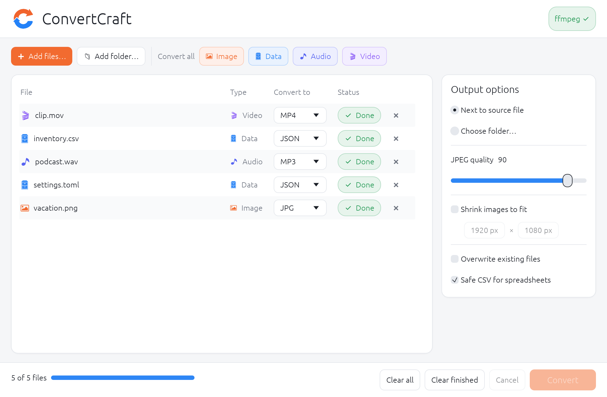

<p align="center">
  
</p>

<h1 align="center">ConvertCraft</h1>

<p align="center"><strong>Your files. A new format. All on your desktop.</strong></p>

<p align="center">
  <a href="https://github.com/PierrunoYT/ConvertCraft/actions/workflows/ci.yml"></a>
  
  <a href="LICENSE"></a>
</p>

<p align="center">
  <a href="#getting-started">Get started</a> ·
  <a href="#supported-formats">Supported formats</a> ·
  <a href="docs/user-guide.md">User guide</a> ·
  <a href="docs/development.md">Development</a>
</p>

ConvertCraft is a native desktop batch converter for **images, structured data, audio, and video** on **Windows, macOS, and Linux**, built with Rust and egui/eframe. Files are processed locally without uploading them to a conversion service. Image and data conversion run in Rust; audio and video use your local FFmpeg installation.



## What you can do

- **Build a batch:** pick multiple files, import a folder recursively, or drag files and folders into the window.
- **Mix formats:** choose a target for each file or apply one target to an entire category.
- **Keep working:** conversions run on up to four background workers, with per-file status and batch progress.
- **Choose your destination:** save beside each source or collect outputs in one folder.
- **Avoid accidental replacement:** overwriting is off by default; filename collisions receive numbered suffixes.
- **Tune image output:** set JPEG quality from 10 to 100 (default 90) and optionally shrink images to fit a maximum width and height.
- **Find the result:** click a completed file's **Done** status to reveal it in your file manager.

## Getting started

### Prerequisites

- A current stable [Rust toolchain](https://rustup.rs/), including Cargo. The crate uses edition 2024; its dependencies may require a newer compiler than the edition's minimum.
- Native build tools for your platform: MSVC tools on Windows, Xcode Command Line Tools on macOS, or a C/C++ toolchain and development libraries on Linux.
- A graphical desktop to run the application. ConvertCraft is not a command-line converter or web app.
- **Optional:** [FFmpeg](https://ffmpeg.org/download.html) on `PATH` for audio and video. Images and structured data work without it.

### Build and launch

```sh
git clone https://github.com/PierrunoYT/ConvertCraft.git
cd ConvertCraft
cargo run --release --locked
```

To build without launching:

```sh
cargo build --release --locked
```

The executable is `target/release/convertcraft` on Linux/macOS or `target/release/convertcraft.exe` on Windows. The Cargo package and executable were previously named `transmute`; update any scripts or shortcuts that use the old name.

### Windows

Install the MSVC build tools (Visual Studio Build Tools with the C++ workload). The executable carries the ConvertCraft icon for Explorer, the taskbar, and shortcuts. For audio and video, add the directory containing `ffmpeg.exe` to `PATH`.

### macOS

Install the Xcode Command Line Tools (`xcode-select --install`), then build a double-clickable app:

```sh
scripts/bundle-macos.sh
```

This builds the release binary and wraps it in `target/release/ConvertCraft.app` with the logo as its icon. Drag the app to `/Applications`, or open it from Finder. A Homebrew FFmpeg (`brew install ffmpeg`) is found even when the app is opened from Finder or the Dock. The bundle is ad-hoc signed, which is enough on the Mac that built it; a copy downloaded from elsewhere needs a Developer ID signature and notarization before Gatekeeper will open it.

### Linux

On Debian/Ubuntu, install the native build and graphics dependencies, plus FFmpeg for audio and video:

```sh
sudo apt-get update
sudo apt-get install build-essential pkg-config libxkbcommon-dev libxkbcommon-x11-0 \
  libwayland-dev libgl1-mesa-dev ffmpeg
```

ConvertCraft runs natively on both X11 and Wayland. File pickers use the desktop's XDG portal service and fall back to `zenity` when no portal is available. If **Add files…** or **Add folder…** does nothing, install `xdg-desktop-portal` with the backend for your desktop, or install `zenity` (`sudo apt-get install zenity`).

### Enable audio and video

Install FFmpeg using your platform's package manager or an FFmpeg build, then check it in the same environment used to launch ConvertCraft:

```sh
ffmpeg -version
```

For example, use `sudo apt-get install ffmpeg` on Debian/Ubuntu or `brew install ffmpeg` on macOS with Homebrew. On Windows, add the directory containing `ffmpeg.exe` to `PATH`.

The header shows **checking ffmpeg…** briefly, then **ffmpeg ✔** (hover for the path in use) or **ffmpeg missing**. Only absolute `PATH` entries are searched, never ConvertCraft's own folder. On macOS, Homebrew's `/opt/homebrew/bin` and `/usr/local/bin` are also searched, because apps opened from Finder or the Dock do not get your shell's `PATH`. Restart ConvertCraft after installing FFmpeg or changing `PATH`: availability is checked at startup. Available encoders depend on your FFmpeg build.

## Convert a batch

1. **Add files.** Use **Add files…**, **Add folder…**, drag and drop, or click the empty queue's browse prompt. Unsupported extensions are skipped.
2. **Select formats.** Set each row's **Convert to** menu, or choose a category under **Convert all**.
3. **Set output options.** Keep **Next to source file** or choose a destination folder. Adjust JPEG quality if needed; leave overwriting off unless you intend to replace existing outputs.
4. **Convert.** Click **Convert** and watch each row move from **Pending** to **Converting…**, then **Done** or **Failed**. The progress bar counts finished jobs, including failures.
5. **Inspect results.** Click **Done** to reveal the output. Hover over **Failed** for the error. **Clear finished** removes successful rows, not files.

Failed rows can be retried with **Convert**. Successful rows are skipped on subsequent runs; remove and re-add a source to convert it again. Queue and option controls are disabled during a batch.

## Supported formats

| Category | Inputs | Outputs | Backend |
| --- | --- | --- | --- |
| Images | PNG, JPG/JPEG, WebP, BMP, GIF, TIF/TIFF, ICO, TGA, QOI, PNM/PBM/PGM/PPM | PNG, JPG, WebP, BMP, GIF, TIFF, ICO, TGA, QOI | Rust `image` |
| Structured data | JSON, YAML/YML, TOML, CSV | JSON, YAML, TOML, CSV | Rust parsers and serializers |
| Audio | MP3, WAV, FLAC, OGG, M4A, AAC, Opus, WMA, AIFF/AIF | MP3, WAV, FLAC, OGG, M4A, Opus | FFmpeg |
| Video | MP4, MKV, WebM, AVI, MOV, WMV, FLV, M4V, MPG/MPEG, TS | MP4, MKV, WebM, AVI, MOV, GIF; MP3/WAV/M4A audio extraction | FFmpeg |

Targets are restricted to each category. Extension recognition is case-insensitive, but it does not guarantee that a file's contents or codecs can be decoded. See the [format reference](docs/formats.md) for encoding presets and exact conversion rules.

## Know before converting

- **Keep originals and backups.** Each output is written to a temporary file and only published after a successful conversion, so a failed job leaves no partial file. Publication is still pathname-based and does not detect every filesystem alias. On Linux and macOS, outputs get the usual permissions for new files (0644 with the common umask); replacing an existing output does not keep its old permissions.
- **Images are not archival copies.** JPEG has no transparency, so transparent areas become white. ICO output fits within 256×256. Image conversion does not preserve animation frames or metadata, and only PNG and TIFF keep 16-bit depth.
- **Data conversion can change representation.** Comments and formatting are lost. CSV infers numbers and booleans, so `1.50` becomes `1.5` and `true` becomes a boolean; values with leading zeros such as `00123` stay text. TOML rejects nulls and wraps non-object roots under `items`. See [data compatibility](docs/formats.md#structured-data).
- **Media is re-encoded.** Fixed presets determine quality and codec selection; there are no bitrate, trimming, subtitle, or stream-selection controls.
- **Sessions are temporary.** Settings and the queue are not saved. A running batch can be cancelled; image and data jobs already in progress finish first.

## Development

```sh
cargo check --locked
cargo test --locked
cargo build --release --locked
```

The existing tests exercise image targets, structured data round trips, output-path collisions, and media conversions. **The media test skips itself when FFmpeg is absent**; install it with the required encoders to exercise that path, or set `CONVERTCRAFT_REQUIRE_FFMPEG=1` to make a missing FFmpeg fail the test. CI runs formatting, Clippy, tests on Linux/Windows/macOS, and `cargo deny check` (see [development docs](docs/development.md#continuous-integration)).

| Path | Responsibility |
| --- | --- |
| [`src/main.rs`](src/main.rs) | Native UI layout, queue, worker scheduling, progress, and file-manager integration |
| [`src/theme.rs`](src/theme.rs) | Light visual style: palette, egui style, cards, and styled buttons |
| [`src/converter.rs`](src/converter.rs) | Format detection, conversion backends, and tests |
| [`src/output.rs`](src/output.rs) | Output planning, batch input protection, and staged publication |
| [`src/import.rs`](src/import.rs) | Bounded background folder scan for file and folder import |
| [`scripts/bundle-macos.sh`](scripts/bundle-macos.sh) | Builds `ConvertCraft.app` on macOS |
| [`assets/screenshots/`](assets/screenshots/) | README screenshot of the main window |
| [`assets/logos/`](assets/logos/) | Transparent logo (`logo.png`) and light/dark previews (`logo-light.png`, `logo-dark.png`) |
| [`docs/`](docs/README.md) | User guide, format details, and architecture |

The window title and in-app name use `APP_NAME` in `src/main.rs`. The embedded logo is decoded once at startup and reused for the native icon and UI texture; no external asset folder is needed beside the compiled executable.

For implementation details and extension guidance, read [Development and architecture](docs/development.md). CI builds and tests ConvertCraft on Windows, macOS, and Linux and builds the macOS app bundle; the user interface itself has no automated tests.

## Documentation and help

- [User guide and troubleshooting](docs/user-guide.md)
- [Supported formats and conversion behavior](docs/formats.md)
- [Development and architecture](docs/development.md)
- [Changelog](CHANGELOG.md)
- [Report an issue](https://github.com/PierrunoYT/ConvertCraft/issues) — include your OS, source/target formats, and the error text; use non-sensitive sample files when possible.

## License

ConvertCraft is licensed under the [GNU General Public License v3.0](LICENSE).
